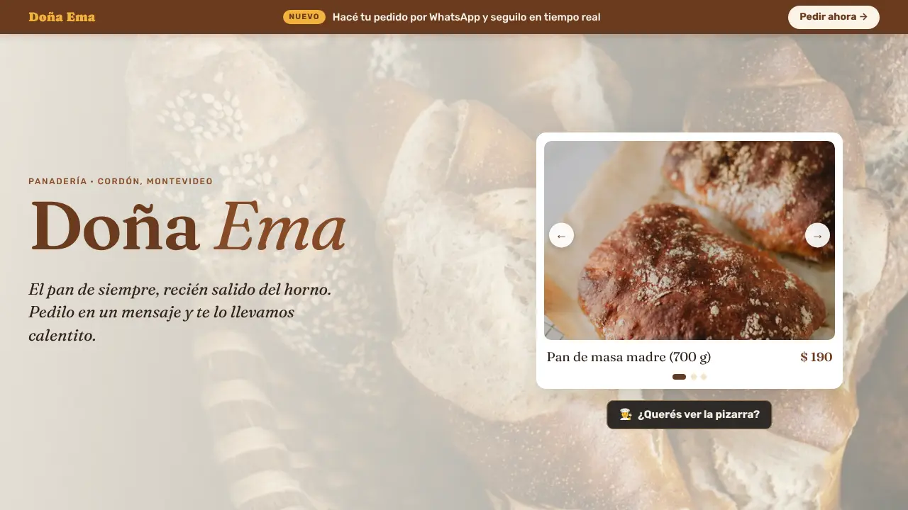

# Panadería Doña Ema — landing page

**Demo:** https://fabricioruy-rdig.github.io/panaderia-dona-ema/



Landing de una panadería de barrio ficticia en Cordón, Montevideo, que lleva años en el barrio y ahora se presenta en la web para recibir pedidos por WhatsApp.

> Proyecto de demostración para mi portafolio. El negocio y sus datos de contacto son ficticios.

## Qué tiene

- **Vitrina de productos** en la portada: carrusel que pasa solo, con flechas, puntos, teclado y deslizar con el dedo. Se queda quieto cuando el usuario lo toca, para mirar con calma.
- **La pizarra:** lista completa de precios en una ventana con estilo de carta.
- **Anuncios de encargos:** carrusel horizontal con botón "Encargar" que arma un mensaje distinto para cada producto.
- **Pedido y seguimiento en tiempo real (simulación):** al enviar un pedido aparece abajo a la derecha un mapa con la moto en camino, las etapas del pedido y el tiempo estimado de llegada.
- **Cartel "Abierto ahora / Cerrado"** calculado con la hora de Montevideo.
- **Bloque de marca** "Así trabajamos en Doña Ema" y franja de cadetería.
- Mapa de OpenStreetMap.
- Diseño adaptado a celular, accesible con teclado y lector de pantalla, y que respeta la opción de reducir movimiento.
- Fotos (WebP) y tipografías guardadas en el proyecto: no depende de servicios externos para verse bien.

## Tecnologías

HTML, CSS y JavaScript, sin frameworks ni librerías.

## Estructura

```
panaderia
├── index.html
├── css/styles.css
├── js/main.js
├── img/        fotos en WebP e ícono
└── fonts/      Caprasimo, Fraunces y Rubik
```

## Créditos

- Fotos de [Unsplash](https://unsplash.com): Jeremy Yap, Victor Rodríguez Iglesias, Markus Spiske, Rebekah Vos, Natalia Gusakova, Uliana Kopanytsia, Thriday y Nathan Dumlao.
- Tipografías con licencia SIL Open Font License: Caprasimo, Fraunces y Rubik.

---

**EN:** One-page site for a fictional neighborhood bakery in Montevideo, Uruguay. Product carousel, price board, custom-order ads, a simulated real-time delivery tracker, and an open/closed badge based on Montevideo time. Plain HTML, CSS and JavaScript. Portfolio demo project.

Diseño y desarrollo: [fabricioruy-Rdig](https://github.com/fabricioruy-Rdig)
